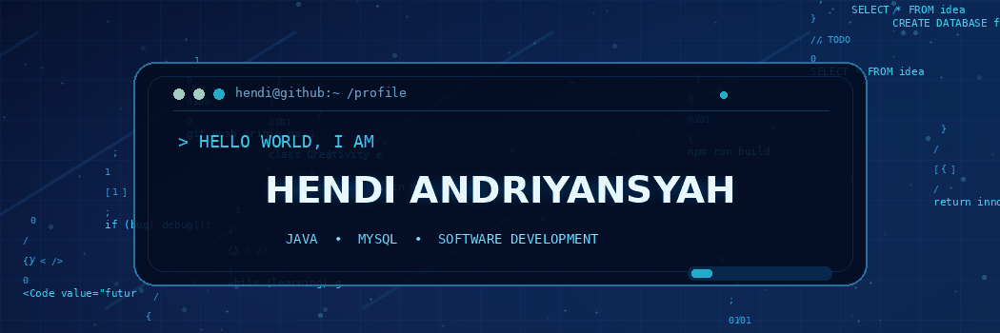
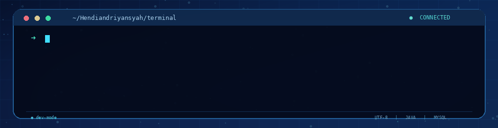
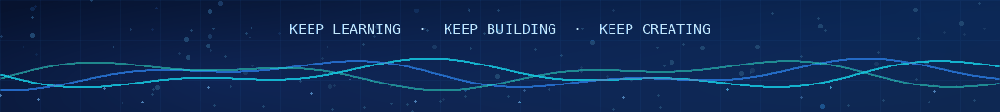

<!--
  GitHub Profile — Hendi Andriyansyah
  Theme: Midnight Navy / Electric Cyan
  Animated GIF assets are stored in /assets.
-->

  <!-- ANIMATED CODING BACKGROUND -->
  

  <!-- ANIMATED TYPING INTRO -->
  

  
<strong>💠 Code. Create. Improve. Repeat.</strong>

  
  
  

---

## 🌌 About Me

Hello! I'm **Hendi Andriyansyah**. I like learning how software works and turning ideas into practical applications.

- 💻 **Main interests:** Java desktop applications, MySQL databases, and web technologies.
- 🛠️ **Tools I explore:** NetBeans, Visual Studio Code, Git, and GitHub.
- 🌱 **Learning:** Writing cleaner, more maintainable code and improving application design.
- 🎯 **Goal:** Build reliable and useful software, one project at a time.
- ⚡ **Motto:** *A little progress every day adds up.*

<!-- ANIMATED TERMINAL -->

  

## 🧰 Tech Stack & Tools

**Languages & Databases**

**Developer Tools**

 

## 📈 GitHub Overview

  
  

<!-- Statistics use external services and may sometimes be rate-limited. -->

## 🚀 Projects & Focus

| Focus | What I Like Building |
|:---|:---|
| ☕ **Java Applications** | Practical desktop interfaces and application logic. |
| 🗄️ **MySQL Databases** | Well-structured data, CRUD features, and reporting. |
| 🎨 **User Interfaces** | Clean layouts that make software easy to use. |
| 🌐 **Web Development** | Exploring front-end fundamentals and interactive pages. |

  

## 🤝 Let's Connect

  
  <!-- Add LinkedIn, portfolio, or email links here. -->

 

  

