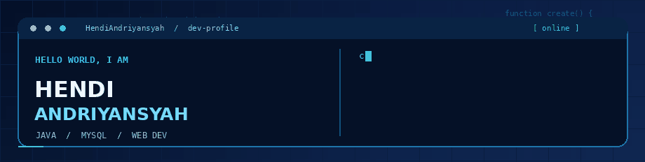

<div align="center">

  

  <h3>💙 Code • Learn • Build • Repeat</h3>

  <a href="https://github.com/Hendiandriyansyah?tab=repositories">
    🚀 My Projects
  </a>
  &nbsp; • &nbsp;
  <a href="https://github.com/Hendiandriyansyah?tab=followers">
    🤝 Follow Me
  </a>

</div>

---

### 👨‍💻 About Me

Hi, I'm **Hendi Andriyansyah**! 👋

I'm interested in developing practical software,
exploring programming, and continuously improving
my technical skills.

- ☕ **Focus:** Java desktop applications
- 🗄️ **Database:** MySQL
- 🌐 **Exploring:** HTML, CSS, JavaScript
- 🛠️ **Tools:** NetBeans, VS Code, Git, GitHub
- 📚 **Learning:** Clean code and UI design

### 🧰 Tech Stack

| Languages | Database | Tools |
|:--|:--|:--|
| Java, HTML, CSS, JavaScript | MySQL | NetBeans, VS Code, Git, GitHub |

### ⚡ What I Like Working On

```java
public class Developer {
    public static void main(String[] args) {
        String name = "Hendi Andriyansyah";
        String mindset = "Keep learning, keep building!";

        System.out.println(name + " | " + mindset);
    }
}
```

### 📂 Explore My Projects

Check out my repositories to see my latest work.

👉 [My GitHub Repositories](https://github.com/Hendiandriyansyah?tab=repositories)

---

<div align="center">
  <sub>💠 Built with curiosity, coffee, and lots of debugging.</sub>
</div>
